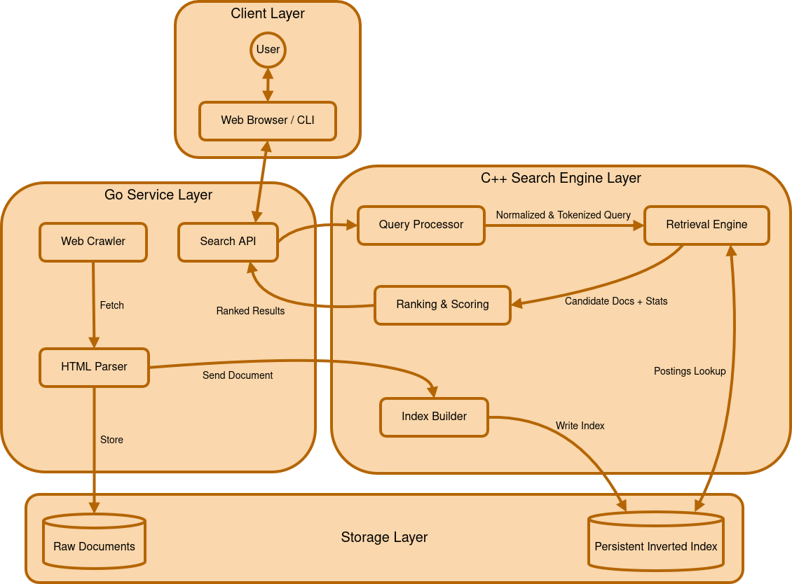
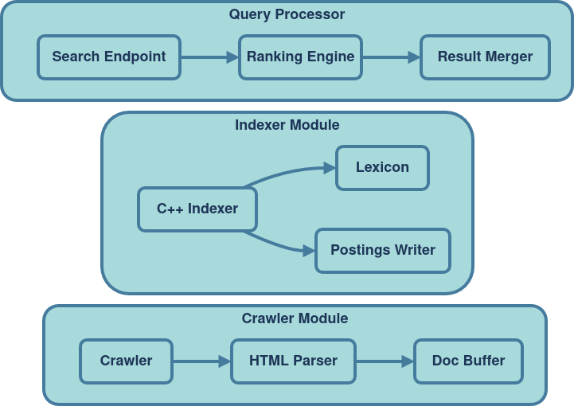
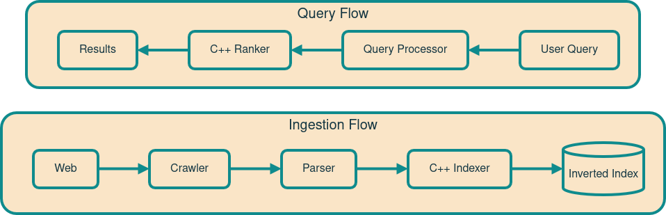
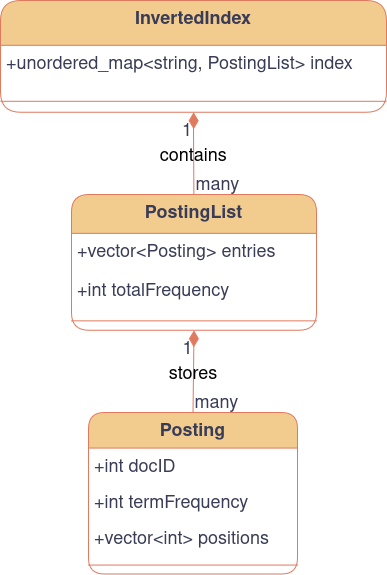
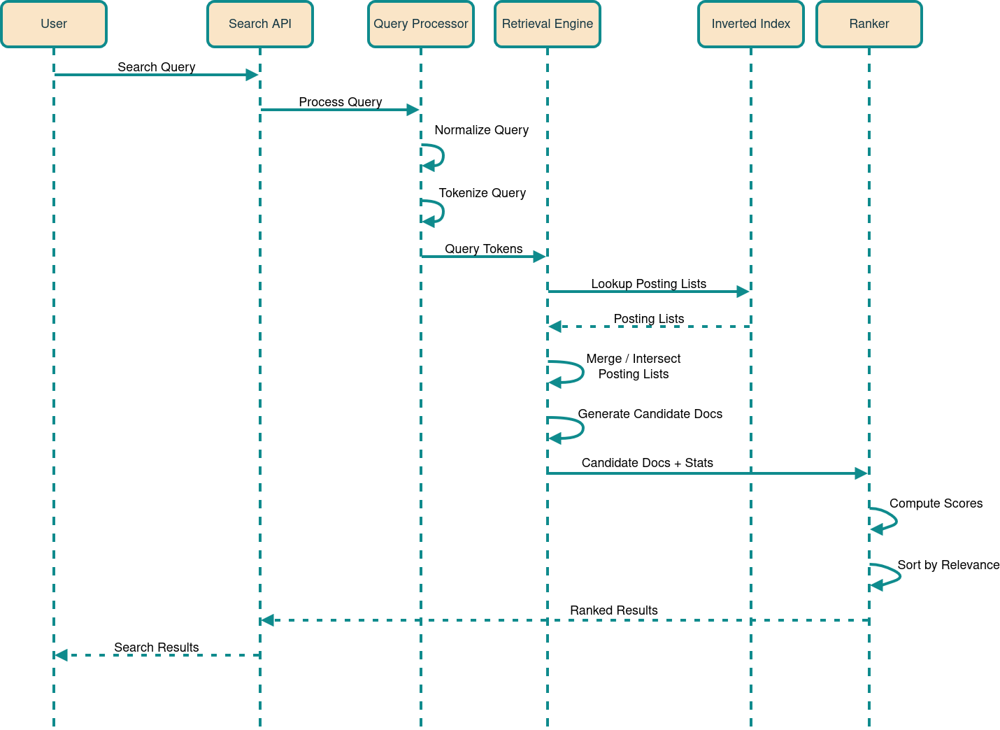

# SeptCrawler

[](https://en.cppreference.com/w/cpp/20)
[](https://go.dev/)
[](#technology-choices)
[](#using-the-search-engine-docker-container)
[](Makefile)

This project is a search engine for retrieving learning resources (documentation, references, tutorials, and discussion forums). I have written the search engine core from scratch in C++, and the service layer in Go. The system is designed to crawl and index learning resources, allowing users to search across them through a focused interface.

> [!IMPORTANT]  
> **Project Status: Complete; in iteration and maintenance phase**  
> SeptCrawler is a personal learning, research, recreational, and portfolio project developed independently by [me](#author).  
> Feedback and discussions are always welcome, but the repository is not intended for external contributions.

> [!NOTE]
>
> 1. Why "SeptCrawler"? I named this project **SeptCrawler** because, first of all, Sept comes from my name, and second of all, the crawler is where everything begins.
> 2. SeptCrawler is designed to crawl, index, rank, and search for technical educational resources. The crawler can target a specified website, but the MVP uses `cppreference` as its controlled corpus to keep the crawling scope and dataset manageable. Support for a broader collection of technical and educational websites is planned as future work.

---

## Contents

- [Documentation Index](#documentation-index)
- [Goal and Motivation](#goal-and-motivation)
- [System Architecture](#system-architecture)
- [Pipelines and Data Flow](#pipelines-and-data-flow)
- [Technology Choices](#technology-choices)
- [Core Internals and Data Structures](#core-internals-and-data-structures)
- [Search Execution Sequence](#search-execution-sequence)
- [Design Decisions](#design-decisions)
- [Using the Search Engine (Docker Container)](#using-the-search-engine-docker-container)
- [References](#references)
- [Author](#author)

---

## Documentation Index

- [High-Level Design (HLD)](./docs/design-details/hld.md)
- [Low-Level Design (LLD)](./docs/design-details/lld.md)
- [C++ / Go Integration](./docs/design-details/cpp-go-integration.md)

---

## Goal and Motivation

The goal of this project is for me to understand how traditional search engines work internally by building one from scratch.
It is intended to strengthen my backend engineering, systems programming, and software design skills, along with my programming, research, and problem-solving abilities as a whole.
I do not intend this to compete with existing search engines, as this is primarily for my learning of how such systems are designed and implemented.
Along the way, my goal is to make something that could be useful for learners and developers like myself searching for focused learning resources, while not having their flow-state disrupted.

---

## System Architecture



The system is organized into two main pipelines:

1. **Ingestion Pipeline (offline):** Crawls and indexes learning resources from the internet.
2. **Query Pipeline (online):** Processes user queries and returns ranked results.

The architecture is split into 3 layers:

- **C++ Search Engine Core Layer:** Inverted index construction, query normalization/tokenization, candidate document retrieval, and ranking.
- **Go Service Layer:** Search API, web crawler, HTML parser, service coordination, network I/O, and client request routing.
- **Storage Layer:** Raw document storage and persistent inverted index storage.

### Component Breakdown



---

## Data Flow



### 1. Ingestion Pipeline (Offline)

`Web -> HTML -> clean docs -> tokens -> inverted index`

1. The Crawler fetches web pages.
2. The HTML Parser extracts structured text from them.
3. Raw documents are stored in the `Raw Documents` storage.
4. The Index Builder then normalizes all the text, tokenizes the content, and builds the inverted index.
5. The inverted index is stored in the `Persistent Inverted Index` storage.

### 2. Query Pipeline (Online)

`Query -> normalized query -> tokens -> postings -> candidate docs -> ranked results`

1. A user enters a query: the client sends a request to the Search API.
2. The API forwards the query to the Query Processor.
3. The Query Processor normalizes and tokenizes the query.
4. The Retrieval Engine uses tokens to look up inverted index, fetches posting lists, and merges the results into candidate docs.
5. The Ranker scores the candidate documents and sorts them by relevance.
6. The API returns ranked results to the user.

---

## Technology Choices

I chose C++ and Go to keep the search engine core separate from the backend service layer.

- **C++ Search Engine Core:** Index builder, query processor, retrieval engine, ranker, and data structures built from scratch in C++.
- **Go Service Layer:** Search API, web crawler, HTML parser, service coordination, network I/O, and client request routing in Go.
- **C++ / Go Integration:** C-compatible API wrapper with `extern "C"` and cgo for in-process communication between the Go service layer and C++ core.

> Basically, Go does not directly talk to my C++ code. cgo lets Go call a C-compatible interface, and bridge.cpp implements that interface by calling my actual C++ search-engine code and converting the results into C-compatible data that Go can consume.

---

## Core Internals and Data Structures



The core data structure in the C++ engine is the inverted index:

- **Inverted Index:** Maps search terms to posting lists (`term -> PostingList`).
- **Posting List:** Contains document entries for each term with document frequency.
- **Posting:** Records `docId`, `termFrequency`, and `positions` within a single document.
- **Candidate Documents:** Generated dynamically during query execution by intersecting posting lists for ranking.

### Current Scope and Data Corpus

The MVP currently operates on a deliberately controlled crawling scope centred on `https://en.cppreference.com`.

- **Crawled Corpus:** 283 pages crawled, parsed and stored as JSON under `data/documents/`.
- **Persistent Inverted Index:** ~28 MB JSON inverted index stored in `data/index/inverted_index.json`.
- **Future Scope:** Broader crawling across multi-domain technical and educational resources is planned as post-MVP future work.

---

## Search Execution Sequence



When a search query is submitted, execution flows from the client through the Go HTTP handler, traverses the C-ABI bridge via cgo into the C++ retrieval engine and ranker, and returns ranked document results back across the boundary.

---

## Design Decisions

1. **Separation of concerns:** Ingestion is separate from query processing, and retrieval is separate from ranking.
2. **Two independent pipelines:** Offline ingestion vs online query processing.
3. **Index is a database, not a pipeline stage:** It is queried, not passed through.
4. **Retrieval is the mandatory bridge:** Without retrieval, the ranker cannot operate and the index cannot be used meaningfully.
5. **In-process C-ABI boundary:** Go calls the C++ core through a thin C-compatible wrapper via cgo, keeping the architecture simple for v1 while isolating language runtimes.
6. **Go owns persistent index storage:** The Go storage layer owns filesystem persistence and reading of `data/index/inverted_index.json`. The C++ core receives the persisted index via the C-compatible bridge rather than accessing the JSON file directly, keeping storage/persistence responsibilities isolated from the search engine core.

> [!NOTE]  
> When I say **online**, I mean work performed while handling a live user request, and **offline** refers to work performed independently of any live user request, typically in the background to prepare data for future searches.

---

## Using the Search Engine (Docker Container)

I containerised SeptCrawler using Docker so that anyone exploring this repository can run and test the search engine locally without needing to manually install or configure `g++`, `make`, cgo environment variables, or Go dependencies on their host machine.

The multi-stage `dockerfile` compiles the static C++ core library (`libseptcrawler_core.a`) and Go binaries, packaging them into an isolated Debian runtime image.

### Building the Image

```bash
docker build -t septcrawler:latest .
```

### Running the Search API Server

```bash
docker run -d -p 8080:8080 -v septcrawler-data:/project/data --name septcrawler-app septcrawler:latest
```

### Running the Ingestion Pipeline (Crawler + Indexer)

```bash
docker run --rm -v septcrawler-data:/project/data septcrawler:latest /project/storage https://en.cppreference.com 2
```

### Testing the CLI Search Tool

```bash
docker run --rm -it -v septcrawler-data:/project/data septcrawler:latest /project/septcrawler-cli "vector clear"
```

---

## References

- https://cppreference.com/cpp
- https://go.dev/doc
- https://bytebytego.com/guides/how-do-search-engines-work
- https://www.geeksforgeeks.org/machine-learning/understanding-tf-idf-term-frequency-inverse-document-frequency
- https://en.wikipedia.org/wiki/Inverted_index
- https://en.wikipedia.org/wiki/Tf%E2%80%93idf

---

## Author

&copy; 2026 [Saptaparno Chakraborty](https://github.com/schak04).  
All rights reserved.

---
